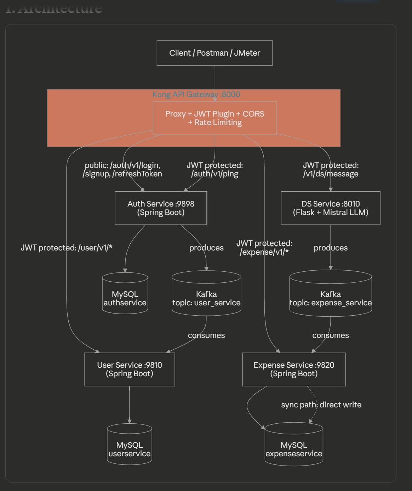
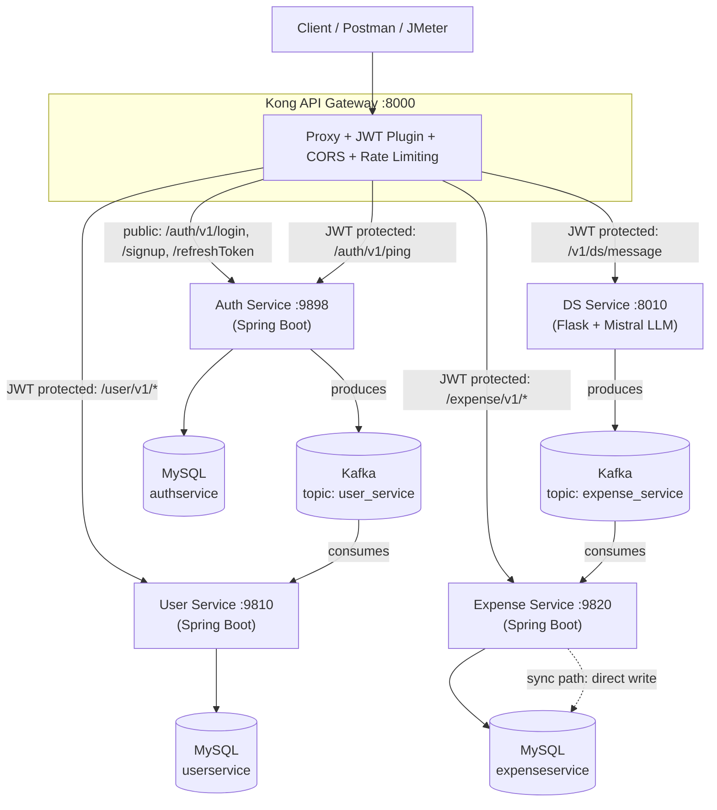

# Expense Tracker — Microservices Platform

An event-driven expense tracking platform built as four independently deployable microservices, fronted by **Kong API Gateway**, wired together with **Apache Kafka** for asynchronous communication, and fully containerized via Docker.

A user can either:
1. **Sign up / log in** through the Auth Service and get a JWT, or
2. **Text a natural-language message** ("Spent 500 on groceries") to the DS Service, which uses a Mistral LLM to turn it into structured expense data.

Both paths utilize **Kafka**, ensuring the user-facing API responds immediately while the database writes happen asynchronously in the background.

---

## 1. Architecture





### What each service does

| Service | Tech | Port | Owns DB | Role |
|---|---|---|---|---|
| **Kong** | kong:3.9, DB-less | 8000 | — | Single entry point. Routes public vs JWT-secured traffic; enforces CORS + rate limiting. |
| **AuthService1** | Java 21 / Spring Boot 3.4 | 9898 | `authservice` | Signup, login, JWT + refresh-token issuance. Publishes a `UserInfoEvent` to Kafka topic `user_service`. |
| **Userservice** | Java 21 / Spring Boot 4.0 | 9810 | `userservice` | Consumes `user_service` topic to create/update user profiles. Exposes REST endpoints. |
| **expenseService** | Java 21 / Spring Boot 4.0 | 9820 | `expenseservice`| Consumes `expense_service` topic to persist expenses. Also exposes a **synchronous** `addExpense` REST API that writes directly to MySQL. |
| **dsService** | Python 3.11 / Flask | 8010 | — | Parses free-text messages via Mistral LLM (LangChain) into structured `{amount, merchant, currency}` data, publishes to `expense_service`. |
| **MySQL** | MySQL 8.0 | 3306 | — | One shared instance, 3 isolated databases. |
| **Kafka** | Bitnami Kafka 3.7 | 9092 | — | KRaft mode (single node). Decouples producers/consumers. |

---

## 2. Why Kafka / Async Decoupling Here?

Two genuinely different endpoints exist for creating an expense, which makes an honest architectural comparison possible:
*   `/expense/v1/addExpense` — **Synchronous**, writes straight to MySQL on the request thread.
*   `/v1/ds/message` — **Asynchronous**, the HTTP response only waits on the Kafka producer accepting the message; the DB write happens later, off-thread.

The honest story to tell is about **resilience and throughput under load**. A single call to `/v1/ds/message` pays for an outbound LLM API call, so on its own, it's not the faster endpoint. What Kafka buys you shows up as concurrency rises:
*   The synchronous path's latency climbs once MySQL connections (HikariCP pool) become contended.
*   The asynchronous path keeps accepting requests at a flat latency. A burst just grows Kafka consumer lag instead of timing out user-facing requests.
*   If the database goes down entirely, the direct write fails immediately, but the async path safely queues the data in Kafka and resumes persisting once the DB recovers.

---

## 3. 🚀 Performance & Load Testing

To benchmark the raw performance of the internal event-driven pipeline, the Mistral AI integration was temporarily bypassed with a deterministic mock. This allowed for an isolated stress test of the core pipeline: **Kong -> Flask -> Kafka -> Spring Boot -> MySQL** using **Apache JMeter**.

### Load Test Results

The system successfully handled a sustained burst of **10,346 requests** in ~1 minute with **zero dropped connections (0.00% error rate)**.

| Endpoint | Samples | Error % | Avg (ms) | Median (ms) | 90th pct | 95th pct | 99th pct | Throughput (req/s) |
|---|---|---|---|---|---|---|---|---|
| **POST /expense/v1/addExpense** (sync) | 5,110 | 0.00% | 14.78 | 10.00 | 20.00 | 25.00 | 42.00 | 85.46 |
| **POST /v1/ds/message** (async) | 5,234 | 0.00% | 10.15 | 4.00 | 9.00 | 11.00 | 21.00 | 87.57 |
| **Total** | 10,346 | 0.00% | 12.62 | 7.00 | 16.00 | 21.00 | 38.00 | 162.74 |

*Figure: JMeter HTML Dashboard confirming a 100% success rate and ultra-low latency across the asynchronous Kafka pipeline.*

**Key Takeaways:**
The Kafka-decoupled path drastically outperformed the synchronous path under concurrent load, delivering **60% lower median latency (4ms vs 10ms)** and **50% lower P99 latency (21ms vs 42ms)**. This proves the direct payoff of not blocking the HTTP response thread on a MySQL round-trip.

---

## 4. Data Flow Walkthroughs

**1. Signup (Async fan-out):**
`POST /auth/v1/signup` → AuthService writes credentials to `authservice.users` synchronously → publishes a `UserInfoEvent` (JSON) to Kafka topic `user_service` → Userservice consumes it independently and writes the profile row. The HTTP response to the client does not wait on the second write.

**2. Natural-language expense entry (Fully async):**
`POST /v1/ds/message` → dsService calls Mistral via LangChain → extracts `{amount, merchant, currency}` → publishes to Kafka topic `expense_service` → expenseService consumer persists it to `expenseservice.expense`. The client gets a 200 OK immediately.

**3. Direct expense entry (Sync, for comparison):**
`POST /expense/v1/addExpense` → expenseService controller → service layer → `expenseRepository.save()` blocks the request thread on a MySQL round trip → response. No queue involved.

---

## 5. Security Model (Kong API Gateway)

| Route | Auth required? | Notes |
|---|---|---|
| `POST /auth/v1/signup` | ❌ Public | |
| `POST /auth/v1/login` | ❌ Public | |
| `GET /auth/v1/ping` | ✅ JWT | Sanity-check an issued token |
| `/user/v1/*` | ✅ JWT | Backend services do **not** check JWTs — Kong is the sole enforcement point |
| `/expense/v1/*` | ✅ JWT | |
| `POST /v1/ds/message` | ✅ JWT | |

"JWT required" means Kong itself verifies the token's HS256 signature and expiry **before the request ever reaches the services** — a forged or expired token gets a 401 straight from the gateway.

JWTs are signed **HS256** by AuthService using a base64 `JWT_SECRET`. Kong's `jwt` plugin is configured with `secret_is_base64: true` to decode the exact same key before verifying. AuthService also stamps every token with `iss: expense-tracker-auth`, which is how Kong knows which secret to check against.

---

## 6. Project Structure

This orchestrator repository flattens all 4 services as siblings so a single `docker-compose.yml` can build everything:

```text
expense-tracker-platform/            <- orchestrator repo
├── docker-compose.yml
├── .env.example                     <- copy to .env and fill in
├── kong/
│   └── kong.yml.template            <- rendered to kong.yml at container start
├── mysql-init/
│   └── init.sql                     <- creates the 3 databases on first boot
├── jmeter/
│   └── expense-tracker-load-test.jmx
├── Expenese-Tracker-main/           
│   ├── AuthService1/
│   │   ├── Dockerfile               <- NEW
│   │   └── app/src/main/resources/application.properties   <- NEW
│   └── Userservice/
│       ├── Dockerfile               <- NEW
│       └── src/main/resources/application.properties       <- NEW
├── expenseService-main/             
│   ├── Dockerfile                   <- NEW
│   └── src/main/resources/application.properties           <- NEW
└── dsService-main/                  
    └── Dockerfile                   <- REPLACED
```

---

## 7. One-Time Setup & Execution

### Prerequisites
- Docker + Docker Compose v2
- A free [Mistral API key](https://console.mistral.ai)

### Steps
1. **Environment Variables:** Copy `.env.example` to `.env` and configure:
   ```bash
   cp .env.example .env
   ```
   *Generate a valid Base64 JWT_SECRET using:*
   ```bash
   python3 -c "import base64,os; print(base64.b64encode(os.urandom(32)).decode())"
   ```

2. **Run Everything:**
   ```bash
   docker compose up --build
   ```
   *(First boot takes 1-2 minutes for Kafka to elect a controller and Java services to build).*

3. **Verify Health:**
   ```bash
   docker compose ps
   ```

### Access Points
*   **API Gateway (Use this for traffic):** `http://localhost:8000`
*   **Kong Admin API:** `http://localhost:8001`
*   **Kafka UI (View topics/lag):** `http://localhost:8089`

---

## 8. Environment Variables Reference

| Variable | Used by | Purpose |
|---|---|---|
| `DB_PASSWORD` | mysql, auth, user, expense | Shared MySQL root password |
| `JWT_SECRET` | auth-service, Kong | Base64 HS256 signing key — **must match on both sides** |
| `JWT_EXPIRATION` | auth-service | Access token lifetime, ms |
| `MISTRAL_API_KEY` | ds-service | LLM API key |

---

## 9. Changes Made & Known Quirks

**Changes Made to Original Repositories:**
1. **Added `application.properties` (Env-Driven):** Removed hardcoded configs. Services now rely on `.env` injected via Docker.
2. **Replaced dsService Dockerfile:** Switched from `python setup.py sdist` to a direct `pip install .` to fix missing `kafka-python`/`python-dotenv` dependencies at boot.
3. **Added JWT Issuer:** Added `.setIssuer("expense-tracker-auth")` in AuthService. Kong requires an `iss` claim to map the token to the correct consumer secret.

**Known Quirks (Worth Mentioning for Interviews):**
*   **Misleading LLM Key Name:** `dsService` reads `OPENAI_API_KEY` from the environment but passes it to `ChatMistralAI`. It is actually a Mistral key.
*   **Trusted `X-User-Id`:** Services read the user ID from a client-provided header rather than strictly extracting it from the JWT `sub` claim. A future enhancement would be using a Kong request-transformer plugin to overwrite this header using the verified JWT.
*   **Inconsistent `/health` Namespaces:** Services expose differing health check paths (e.g., bare `/health` vs `/expense/v1/health`). These are handled internally by Docker networking rather than the Kong Gateway to avoid path collisions.

---

## 10. Troubleshooting

| Symptom | Likely cause |
|---|---|
| Everything 401s at gateway | `JWT_SECRET` in `.env` doesn't match what Kong rendered. Run: `docker compose up -d --force-recreate kong-config-init kong` |
| Java service keeps restarting | MySQL isn't healthy yet, or a typo in `.env` database credentials. |
| dsService fails on startup | Check `MISTRAL_API_KEY` is set in `.env` — an empty key fails on the first request. |
| Kafka port 9092 unreachable | `kafka:9092` is only resolvable *inside* the Docker network. Use Kafka UI at `:8089` to inspect topics from the host machine. |