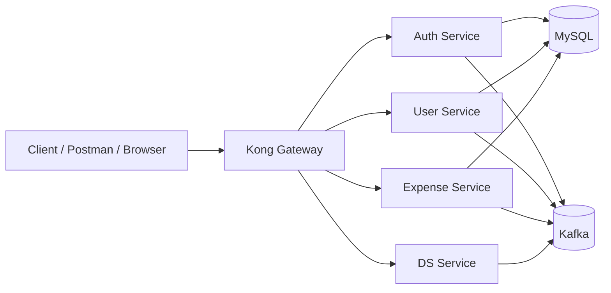

# Expense Tracker Platform

A full-stack, microservices-based expense tracking platform that combines Spring Boot services, a Python-based intelligence service, Kong API Gateway, Docker networking, and a custom authentication layer. This project is designed to demonstrate a realistic distributed architecture for modern backend systems, with clear separation of concerns between authentication, user management, expense processing, analytics, and API routing.

This repository is a strong example of a production-style backend setup that can be used for learning, portfolio presentation, or real-world extension into a larger SaaS-style application.

---

## 1. Project Overview

The Expense Tracker Platform is built as a multi-service system where different responsibilities are handled by separate components:

- Authentication and token-based access control are managed by the Auth service.
- User profiles and identity-related operations are handled by the User service.
- Expense-related business logic is processed separately through the Expense service.
- A Python-based data service adds analytics or intelligent processing capabilities.
- Kong acts as the API gateway and routes external requests to the correct internal service.
- Docker is used to orchestrate the services and the shared network environment.

The system is intended to showcase:

- Microservices architecture
- API gateway integration
- Service-to-service communication
- Docker-based deployment
- Authentication and authorization flow
- Event-driven communication with Kafka
- Database-backed services with MySQL

---

## 2. Architecture

The platform follows a layered and modular architecture:



### High-Level Flow

1. A client sends a request to the Kong gateway.
2. Kong routes the request based on its configuration.
3. The target service handles the corresponding business logic.
4. Services interact with MySQL for persistence and Kafka for event-driven communication.
5. The data/analytics service consumes or processes relevant data as part of the broader workflow.

---

## 3. Main Components

### Auth Service

The Auth service is responsible for authentication, token generation, and secured access for protected endpoints.

Key responsibilities:
- User sign-in and authentication flow
- JWT-based access handling
- Secure communication with the database
- Integration with the gateway layer

Technology highlights:
- Java
- Spring Boot
- Spring Security
- JWT
- MySQL
- Kafka

---

### User Service

The User service handles user-related operations and provides the backend logic for user identity and profile management.

Key responsibilities:
- User creation and management
- User-specific data handling
- Integration with shared infrastructure services
- Interaction with Kafka when user events are propagated

Technology highlights:
- Java
- Spring Boot
- JPA / Hibernate
- MySQL
- Kafka

---

### Expense Service

The Expense service manages expense-related business logic and is designed to be a core domain service within the system.

Key responsibilities:
- Expense creation and updates
- Domain-specific business rules
- Persistence in the database
- Event communication across services

Technology highlights:
- Java
- Spring Boot
- MySQL
- Kafka

---

### DS Service

The DS service is a Python-based service that adds data or intelligence capabilities to the platform.

Key responsibilities:
- Processing or analysis of data
- Integration with LLM / AI-related workflows where applicable
- Communication with the broader service ecosystem

Technology highlights:
- Python
- Flask
- LangChain / OpenAI-compatible tooling
- Docker-ready deployment

---

### Kong API Gateway

Kong is used as the API entry point for the whole system. It provides request routing, centralized exposure, and plugin-based custom authentication.

Key responsibilities:
- Routing incoming APIs to the appropriate service
- Enforcing gateway-level policies
- Supporting custom authentication plugins
- Centralizing access to the platform

Technology highlights:
- Kong Gateway
- Declarative config
- Custom Lua-based plugin support

---

## 4. Technology Stack

### Backend
- Java 21
- Spring Boot
- Spring Security
- Spring Data JPA
- Spring Kafka
- JWT

### Data Layer
- MySQL
- Kafka
- Zookeeper

### Gateway / Infra
- Kong
- Docker
- Docker Compose

### Intelligence Layer
- Python
- Flask
- LangChain / OpenAI-compatible packages

---

## 5. Repository Structure

```text
EXPENSE_TRACKER/
├── AuthService1/            # Authentication service
├── Userservice/             # User service
├── dsService-main/          # Python-based data/intelligence service
├── config/                  # Kong declarative config
├── custom-plugins/          # Kong custom auth plugin files
├── docs/                    # Documentation and setup notes
├── services.yml             # Docker Compose service orchestration
├── kong.yml                 # Kong config file
└── Readme.md                # Project documentation
```

---

## 6. Docker and Network Setup

The project is designed to run in a shared Docker network with the following major services:

- Zookeeper
- Kafka
- MySQL
- Auth Service
- User Service
- Expense Service
- DS Service
- Kong Gateway

This setup makes the platform behave like a realistic distributed system where services are loosely coupled and communicate through a common internal network.

### Start the environment

From the repository root, run:

```bash
docker compose -f services.yml up -d
```

### Stop the environment

```bash
docker compose -f services.yml down
```

---

## 7. Local Development Setup

### Prerequisites

Make sure the following are available:
- Docker Desktop / Docker Engine
- Java 21
- Python 3.x
- Gradle wrapper available in the Java service folders

### Run the Java services

For the Spring Boot services, use the Gradle wrapper in each project folder:

```bash
cd AuthService1
./gradlew bootRun
```

```bash
cd Userservice
./gradlew bootRun
```

### Run the Python service

```bash
cd dsService-main
python -m venv dsenv
source dsenv/Scripts/activate
pip install -r requirements.txt
python setup.py sdist
```

If the service uses Flask or other runtime entry points, run them from the service folder after installing dependencies.

---

## 8. API Gateway Access

Once the services are running, Kong acts as the entry point for the platform.

Typical entry points:
- Gateway port: 8000
- Admin port: 7990 (depending on configuration)

You can use Kong to route calls to the appropriate backend service based on the declared routes and plugins.

---

## 9. Documentation

Additional notes and supporting documentation are located in the docs folder:

- API gateway references
- Docker-related notes
- Debugging guides
- Setup and environment help

The docs folder is useful for understanding the architecture in more detail and for troubleshooting common development issues.

---

## 10. Why This Project Is Valuable

This repository is not just a simple CRUD app. It demonstrates a more professional and realistic engineering structure:

- Distributed backend services
- API gateway pattern
- Secure authentication design
- Dockerized deployment
- Multi-language service ecosystem
- Strong portfolio-ready architecture

It is a great project to showcase if you want to demonstrate skills in:
- Backend development
- Microservices architecture
- DevOps and containerization
- API gateway concepts
- Full-stack system thinking

---

## 11. Summary

The Expense Tracker Platform is a comprehensive example of a modern backend architecture that combines multiple services into one cohesive system. It is built to be educational, extensible, and impressive for technical review, internship interviews, job applications, or portfolio presentation.

If you want, the next step can be to add:
- a proper architecture diagram image
- a setup guide with screenshots
- a demo API collection
- deployment instructions for a cloud environment
